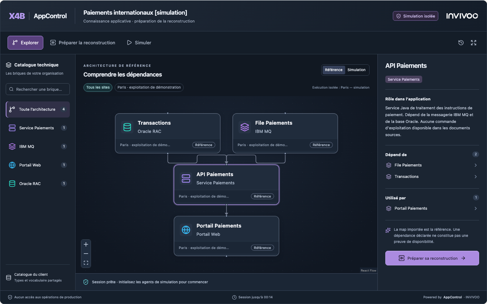
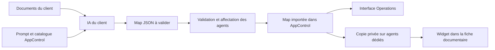

# AppControl Embedded — cartographie et reconstruction simulée

AppControl Embedded permet d'intégrer une architecture interactive dans une fiche
applicative ou un portail documentaire. AppControl conserve le modèle, le rendu,
les scénarios, les calculs de dépendances et le runtime. L'hôte accueille le module.





Les deux parcours utilisent le même moteur AppControl. La copie du widget
possède ses propres identifiants, ses fichiers témoins et ses autorisations.

## Le parcours d'intégration

1. Transformer les configurations de référence du client en catalogue JSON.
2. Importer ce catalogue par `POST /api/v1/catalog/component-types/import`.
3. Récupérer `GET /api/v1/map-generation/contract?profile=standard&include_catalog=true`.
   `catalog_types` permet de sélectionner les seules briques utiles à l'application.
4. Le moteur d'IA du client reçoit `system_prompt` et `user_message_template`, dans
   lequel `{{input_documents}}` est remplacé par les documents sélectionnés. Un
   moteur acceptant un message unique peut concaténer ces deux parties.
5. Valider le résultat par `POST /api/v1/maps/validate`. Une erreur bloque l'import.
   Le client peut renvoyer les diagnostics au modèle pour une correction bornée,
   conserver les candidats rejetés et revalider ; il ne réécrit pas silencieusement
   les commandes ni les données de la map.
6. Préparer les affectations avec `/api/v1/map-generation/prepare`, puis importer
   avec `/api/v1/map-generation/import`. Le profil `standard` conserve les commandes
   fournies ; `mock-linux` est une transformation explicite pour les démonstrations.
7. Exploiter la map dans `/apps/<id>` ou ouvrir son parcours Embedded depuis la map.
8. Le serveur du portail crée une session limitée pour son utilisateur. Le widget
   utilise ensuite ses propres API et sa propre copie de simulation.

L'IA reste externe au produit. Les prompts, le contrat et les règles d'import sont
fournis par la version d'AppControl installée. Voir [MAP_GENERATION.fr.md](MAP_GENERATION.fr.md).

La révision de prompt actuelle est `7`. Elle conserve le site documenté dans
`source_site` et laisse les profils de rattachement absents quand les hôtes
d'exécution sont inconnus. La révision du
prompt, la version de contrat (`1`) et le format de map (`4.2`) sont des notions
distinctes. Récupérer le contrat de l'instance cible plutôt que figer son texte.

## Alimenter le catalogue du client

Le catalogue est celui des **types de composants techniques**. Chaque brique a une
clé stable `type_key`, reprise dans `component_type` des maps. Les commandes sont
facultatives : un catalogue descriptif suffit pour préparer la présentation et
guider la génération. Le catalogue n'infère pas les comportements de reprise d'une
application à partir de son nom ou de son icône.

L'import `/api/v1/catalog/component-types/import` accepte de 1 à 1 000 entrées.
Toutes les entrées sont validées avant écriture ; les définitions et leur historique
de configuration sont écrits dans une même transaction. Deux modes sont disponibles :

| Mode | Comportement |
|---|---|
| `add` (défaut) | Crée les nouvelles clés et conserve les entrées déjà présentes. |
| `upsert` | Crée ou remplace les définitions personnalisées indiquées, après prévisualisation. |

Prévisualiser les changements :

```http
POST /api/v1/catalog/component-types/import
Content-Type: application/json

{
  "mode": "upsert",
  "dry_run": true,
  "entries": [
    {
      "type_key": "ibm-mq",
      "label": "IBM MQ",
      "description": "Messagerie applicative",
      "icon": "layers",
      "color": "#A78BFA",
      "category": "Messagerie"
    }
  ]
}
```

La réponse contient `digest`, `created`, `updated`, `unchanged`, `skipped` et les
`changes` par clé avec leurs champs modifiés. Pour appliquer, envoyer **les mêmes
définitions**, `dry_run: false` et `expected_digest` égal au `digest` reçu. Un
catalogue modifié entre-temps produit `409` : demander un nouvel aperçu avant
d'appliquer. Les définitions intégrées restent protégées et aucune clé absente
du lot n'est supprimée.

En mode `upsert`, une entrée est une définition complète : les propriétés
facultatives omises sont effacées ou reçoivent leur valeur par défaut. Par exemple,
omettre `default_start_cmd` retire cette commande du type personnalisé. Ce n'est
pas la sémantique du `PUT` partiel historique. Relire le diff avant application.

Une clé de serveur peut recevoir `catalog:read` pour consulter le catalogue et
l'inclure dans le contrat IA, et `catalog:write` pour ses mutations. Ces capacités
sont distinctes de `maps:import` et `app:<id>:simulate` ; elles ne donnent aucun
droit de démarrage/arrêt. Les mutations du catalogue exigent toujours un
propriétaire de clé administrateur. Aucun mot de passe ni secret d'exécution ne
doit être transmis au modèle avec les définitions.

Une modification du catalogue ne réécrit pas automatiquement les commandes des
maps déjà publiées. Regénérer un candidat, comparer et republier explicitement.

## Quatre notions à distinguer

| Notion | Effet |
|---|---|
| Redémarrage | Arrêt puis relance du runtime ; pas de reconstruction d'installation |
| Reconstruction applicative | Procédure `rebuild_cmd`, contrôles et démarrage |
| Reconstruction infrastructure et application | `rebuild_infra_cmd`, reconnexion de l'agent, `rebuild_cmd`, contrôles et démarrage |
| Bascule | Changement du site actif ; synchronisation et trafic externe nécessitent leur propre contrat |

Le parcours **Diagnose & recover** présente le site, le périmètre, la stratégie, les
prérequis, le plan ordonné et ses résultats. Les opérations quotidiennes sont dans
**Operations**. Le redémarrage avec dépendants est une opération serveur atomique :
le navigateur ne coordonne pas lui-même un arrêt suivi d'un démarrage.

Un aperçu `dry_run` n'est pas une simulation exécutée. L'aperçu de reconstruction
peut exécuter les sondes configurées pour obtenir des preuves fraîches. Le widget
utilise ces mécanismes uniquement sur sa copie isolée.

## Configurer les cibles de simulation

Enrôler des agents Linux et gateways **dédiés**, dans des sites autorisés. Aucun
composant opérationnel ne doit utiliser ces agents ou leurs gateways.

Configurer le backend :

```text
APPCONTROL_EMBEDDED_ALLOWED_ORIGINS=https://wiki.banque.example
APPCONTROL_EMBEDDED_SIMULATION_TARGETS=[{"site_id":"UUID_SITE","agent_id":"UUID_AGENT","gateway_id":"UUID_GATEWAY"}]
```

Les origines sont exactes, sans chemin ni wildcard. HTTP est réservé au développement
sur loopback. Chaque cible doit correspondre à des identités enrôlées, actives et
connectées de la même organisation. Le serveur revalide les autorisations et le
chemin d'exécution pendant les scénarios. Une configuration absente désactive l'accès.

Pour ouvrir aussi le widget depuis l'interface native, ajouter l'origine exacte
d'AppControl à cette liste, séparée par une virgule. Par exemple :
`https://wiki.banque.example,https://appcontrol.banque.example`. La page native
`/apps/<id>/embedded` propose les environnements éligibles par leur nom ; il
n'est pas nécessaire d'y saisir des UUID. L'API
`GET /api/v1/apps/<id>/embedded-options` fournit ces choix autorisés au serveur hôte.

Le widget fonctionne avec le même runtime Rust. Les commandes source, variables,
commandes natives et procédures du catalogue ne sont pas copiées dans la simulation.
AppControl génère ses propres commandes sur des fichiers isolés par session et par
composant. Trois états distincts représentent l'environnement, l'installation et
le processus. Une panne de processus, une installation endommagée ou une perte
simulée d'environnement conduisent ainsi à des reconstructions différentes.

Les états simulés ne prouvent pas la réplication de données, le RTO ou la réussite
d'une reprise réelle. Les calculs d'impact concernent les dépendances fortes du
modèle ; ils ne remplacent pas les contrôles métier de chaque consommateur.

### Helm / OpenShift

Les valeurs du chart configurent ensemble l'autorisation backend et l'encadrement
HTTP du widget :

Lors d'une mise à jour, terminer d'abord le déploiement de cette version sur
toutes les instances backend, puis activer les origines et cibles Embedded.
Ne pas créer de copies privées pendant qu'une ancienne instance, qui ne connaît
pas leur isolation, reçoit encore des requêtes.

```yaml
embedded:
  allowedOrigins:
    - https://wiki.banque.example
  simulationTargets:
    - site_id: UUID_SITE
      agent_id: UUID_AGENT
      gateway_id: UUID_GATEWAY
```

Les pages Operations restent protégées contre l'intégration dans un iframe. Seule
la route documentaire `/embedded/<session-id>` autorise les origines explicitement
configurées. Pour un reverse proxy personnalisé, reporter cette exception précise
et la CSP `frame-ancestors`, sans ouvrir l'ensemble d'AppControl à l'encadrement.
Le portail doit aussi autoriser le script et l'iframe AppControl dans sa propre CSP.
Son `style-src` doit autoriser cette même origine pour charger la feuille externe
`/appcontrol-embedded.css`, utilisée dans le Shadow DOM du Web Component. Le SDK
n'injecte pas de bloc de style inline et n'exige pas `unsafe-inline` pour l'hôte.
Les configurations Docker nginx statiques doivent recevoir cette adaptation explicite ;
le simple téléchargement du Web Component ne modifie pas un reverse proxy existant.

### Kit PowerShell / OpenShift

Dans `configuration.json`, renseignez `embedded.allowed_origins` et
`embedded.simulation_sites`. Le kit résout les identités après l’enrôlement
de l’agent et de la gateway de chaque site dédié, puis configure l’exception
d’encadrement. [Exemple complet du kit](qualification/INSTALLATION-WINDOWS.fr.md#activer-embedded-pour-panoramisk)

## Relier les fiches à leur map AppControl

Le job de publication reçoit l’identifiant stable de la fiche Panoramix, par
exemple `PAI-042`. Après validation du JSON généré, le job passe cette identité
dans l’enveloppe de `POST /api/v1/map-generation/import`.

```json
{"source_reference":{"system":"panoramisk","id":"PAI-042"}}
```

`source_reference` accompagne les autres champs de la requête d’import. Le
référentiel fournit sa valeur et le modèle génère la topologie. AppControl
associe la référence à l’UUID créé et garantit son unicité dans l’organisation.
L’association devient disponible à la recherche après un import réussi. Pour
une map déjà importée, un gestionnaire autorisé peut associer la même référence
avec `PUT /api/v1/apps/<application-id>/source-reference`, avec le corps
`{"system":"panoramisk","id":"PAI-042"}`. [Contrat d’import](MAP_GENERATION.fr.md#associer-la-map-a-la-fiche-source)

Le portail conserve dans sa configuration serveur l’URL AppControl, le système
source `panoramisk` et une clé de simulation. Le gabarit de l’onglet
**Architecture** utilise l’identifiant de la fiche courante. À l’ouverture,
le serveur du portail envoie la requête suivante.

```http
GET /api/v1/embedded/resolve?system=panoramisk&id=PAI-042
Authorization: ApiKey <cle-du-serveur-hote>
```

- `200` contient `application_id`. Utilisez cet UUID pour créer la session du widget.
- `404` signifie qu’aucune map publiée n’est disponible dans le périmètre de
  cette clé pour cette référence. Affichez « Aucune map AppControl disponible pour cette fiche ».
- Une erreur d’authentification ou de connexion appelle un état indisponible.
  Le portail peut renouveler sa vérification avant d’ouvrir une session.

AppControl résout la référence à chaque requête. Le portail génère toutes ses
fiches avec le même gabarit et utilise l’identifiant de chaque fiche dans son
appel au serveur. La copie ponctuelle reste accessible dans le menu de la map
avec **Copy application ID**, et dans **Simulate → Intégrer dans
un portail documentaire** pour le fragment HTML et JavaScript.

## Session, authentification et Web Component

Le portail garde la clé dans sa configuration serveur. Le compte propriétaire
de la clé doit pouvoir consulter la map et son site dans AppControl. Le profil
choisi borne ce périmètre. Dans **API Keys → Create API Key**, utilisez le compte
de service du portail pour créer l’un des profils suivants.

| Profil | Périmètre |
|---|---|
| **Embedded portal — selected maps** | Une liste de maps, chacune avec `app:<id>:simulate`. |
| **Embedded portal — all maps the account can view** | `simulate` sur les maps que le compte de service peut consulter. |

Dans le POC, Panoramis est accessible sans authentification. Tous les visiteurs
consultent les mêmes fiches et partagent le périmètre de la clé de service.
Choisissez **Embedded portal — all maps the account can view** pour retrouver
les maps publiées que ce compte peut consulter. Quand Panoramis identifiera
ses utilisateurs, le portail pourra vérifier leur périmètre applicatif avant
chaque résolution et ouverture de session. Le profil **Import new application
maps** sert à la publication.

```http
POST /api/v1/apps/<application-id>/embedded-sessions
Authorization: ApiKey <cle-du-serveur-hote>
Content-Type: application/json

{"parent_origin":"https://wiki.banque.example","simulation_site_id":"UUID_SITE","ttl_seconds":1800}
```

La réponse contient `session_id`, `token`, `expires_at`, `embed_path` et
`reference_application_id`. Le jeton Embedded est opaque, conservé seulement en
mémoire, et ne permet pas d'appeler les API d'exploitation. Il expire au plus tard
après une heure. Un maximum de cinq sessions actives par compte AppControl
émetteur limite les copies simultanées. Si un portail partage une clé de compte
technique, tous ses visiteurs partagent ce quota. Les copies sont réservées à
la simulation.

La capacité `simulate` est un plafond sur les droits existants, pas un droit de
démarrage, de reconstruction de production ou d'import. Si la clé émettrice est
révoquée ou si son propriétaire perd l'accès à l'application, le jeton Embedded
cesse lui aussi d'autoriser les demandes. Les API Embedded n'acceptent pas les
cookies de l'interface Operations à la place de leur jeton dédié.

```html
<script src="https://appcontrol.banque.example/appcontrol-embedded.js"></script>
<appcontrol-map id="architecture"
  backend-url="https://appcontrol.banque.example"
  data-source-app-id="PAI-042"
  title="Architecture et reconstruction">
</appcontrol-map>
```

Dans le JavaScript de l'hôte :

```javascript
await customElements.whenDefined('appcontrol-map');
const widget = document.querySelector('#architecture');
const fiche = encodeURIComponent(widget.dataset.sourceAppId);
const response = await fetch(`/api/fiches/${fiche}/session-appcontrol`, { method: 'POST' });
if (!response.ok) throw new Error('Session indisponible');
widget.session = await response.json();
```

Le gabarit renseigne `data-source-app-id` avec l’identifiant de la fiche courante.
L’API `/api/fiches/<identifiant>/session-appcontrol` appartient au portail. Elle
résout la référence de la fiche, puis crée la session avec la clé de service.
Un portail authentifié peut y appliquer les droits propres à chaque utilisateur.
Le module n'impose ni React ni une dépendance métier à Panoramisk.

Le Web Component encapsule un iframe et transmet le jeton par un handshake
`postMessage` contrôlant l'origine, la fenêtre et l'identifiant de session. Il ne
stocke le jeton ni dans les attributs, ni dans l'URL, ni dans `localStorage`.
Événements disponibles : `appcontrol:component-selected` et
`appcontrol:scenario-completed`, sans jeton dans leur contenu.

### API de session et cycle de vie

Avec `Authorization: Bearer <token Embedded>`, utiliser uniquement les routes de
cette session. Le Web Component renseigne également `X-AppControl-Host-Origin` :

| Appel | Résultat |
|---|---|
| `GET /api/v1/embedded/sessions/<id>` | Référence filtrée, états de simulation, catalogue sans commandes et historique. |
| `POST /api/v1/embedded/sessions/<id>/scenarios` | Lance un scénario ; `202` signifie accepté, pas terminé. Suivre son statut avec `GET`. |
| `DELETE /api/v1/embedded/sessions/<id>` | Révoque le jeton et suspend les contrôles de la copie. |

Les scénarios comprennent `initialize`, `component_outage`, `application_damage`,
`infrastructure_damage`, `site_loss`, `plan`, `recover` et `reset`. Une
reconstruction exige d'abord `plan`, puis `recover` avec le `plan_token` reçu
dans `expected_plan_token`. Le serveur revalide le plan avant d'exécuter.
Les identifiants de composants sont ceux de la copie retournée dans `map`, pas
les UUID des composants de production. La référence et ses commandes restent
inchangées pendant les scénarios.

| Limite | Valeur actuelle |
|---|---|
| Durée demandée | 60 à 3 600 secondes ; 1 800 par défaut |
| Sessions actives | 5 par compte AppControl émetteur, 50 par organisation |
| Quota de sessions conservées récentes | 200 par organisation, comptées avec une expiration postérieure à maintenant moins 24 h |
| Taille de référence | 1 à 100 composants, au plus 500 dépendances |
| Historique | Au plus 100 scénarios par session ; une seule opération à la fois |

Un entretien périodique, environ toutes les 30 secondes, suspend les copies
expirées ou révoquées et retire leur configuration des agents. Après 24 heures
d'expiration, il supprime les composants privés de simulation s'il n'y a plus
d'opération active. Il conserve les enregistrements de session, la référence
capturée et les preuves d'exécution ; les journaux append-only ne sont pas purgés
par ce mécanisme. Il ne s'agit pas d'une suppression intégrale des fichiers
témoins sur les agents ou d'une politique générale de rétention documentaire.

## Scénarios et limites de cette version

Le widget permet l'exploration, les filtres de catalogue, la préparation de
reconstruction, l'initialisation, les pannes de composant ou d'installation,
la perte simulée du site d'exécution, le plan et la reconstruction vérifiée.
Les résultats proviennent du backend et des agents, avec historique de session.

La référence est capturée à la création de la session. Une modification ultérieure
de la map opérationnelle nécessite une nouvelle session pour être prise en compte ;
ce widget ne diffuse pas les états de production en direct dans le portail.

Chaque session exécute sur **une cible isolée**. Une autre cible configurée peut
accueillir une session distincte ; cela ne constitue pas encore une bascule
inter-sites dans un même scénario. L'édition libre de topologie et la validation
humaine de provenance ne sont pas livrées par ce premier incrément. Les capacités
renvoyées par l'API évitent d'afficher ces fonctions comme disponibles.

Les sites et associations de la référence peuvent être consultés dans le graphe.
Leur présence ne signifie pas que des commandes s'exécutent sur ces sites :
`execution_site` identifie séparément l'environnement isolé utilisé. Le scénario
`site_loss` rend indisponibles les marqueurs de **toute cette copie** ; il ne
simule pas une perte de Paris laissant une seconde copie Lyon active. Les
applications imbriquées, clusters `fan_out` et tâches manuelles nécessitent un
modèle Sandbox explicite et sont refusés dans ce premier périmètre.

Dans Operations, la reconstruction d'une machine totalement inaccessible exige
encore une procédure explicite de preuve d'absence/isolement depuis un contrôleur
survivant. Le parcours existant demande un arrêt vérifié avant reconstruction.
Les fichiers de simulation conservent un agent disponible ; ils ne valident pas
ce cas d'infrastructure réelle. La phase de bascule ne synchronise pas elle-même
les données et ne modifie pas le routage externe.

## Démonstration rejouable

Le dossier [demo-rebuild/embedded](https://github.com/xcomponent/appcontrol-release/tree/main/demo-rebuild/embedded) fournit deux documents
synthétiques, un catalogue, un hôte documentaire et un runtime local avec trois
chaînes d'exécution réelles : exploitation de démonstration, Paris simulation et
Lyon simulation. Voir son [mode d'emploi](https://github.com/xcomponent/appcontrol-release/blob/main/demo-rebuild/embedded/README.fr.md).
