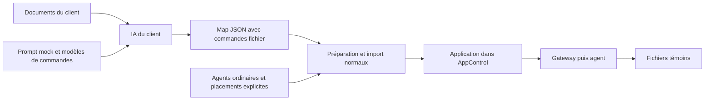

# Générer des commandes simulées, puis importer normalement

La simulation est un **choix de prompt**. Avec `mock-linux` ou `mock-windows`, l’IA du client conserve l’architecture décrite et génère des commandes qui créent, contrôlent ou suppriment des fichiers témoins. AppControl importe ensuite cette map comme toute autre application, avec ses agents ordinaires, ses sites et ses équipes.

Aucun registre d’agents mock, agent spécial, réglage global de simulation ou script de préparation dédié n’est obligatoire. Les applications réelles et simulées peuvent coexister dans la même instance. Ce sont les commandes de chaque map qui déterminent ce qu’elle fait. Le [parcours général](MAP_GENERATION.fr.md) reste la référence pour les droits, les placements et la publication.

Ce parcours est disponible à partir d'**AppControl 1.21.1**. Le kit Windows
léger **1.21.1-2** livre les helpers et ce guide ; les images de la même release
fournissent les routes décrites ci-dessous. Un script ou un prompt récent ne
remplace pas une mise à jour du serveur si ces routes sont absentes. Consulter
les preuves de la livraison exacte pour ses résultats de qualification.



## 1. Choisir le prompt

Récupérez `GET /api/v1/map-generation/contract?profile=mock-linux`, ou `profile=mock-windows` pour les agents Windows. Transmettez `system_prompt` et les documents de l’application à votre propre moteur d’IA. AppControl n’appelle aucun modèle. Le contrat peut être mis en cache avec son ETag.

Le contrat fournit `mock_command_templates.check`, `.start` et `.stop`. L’IA les développe avec des clés distinctes et sûres pour l’application, le composant et chaque membre. Par défaut, les commandes Linux utilisent `$HOME/.appcontrol-mock` ; celles de Windows utilisent PowerShell et `%LOCALAPPDATA%\AppControlMock`. La variable d’environnement facultative `APPCONTROL_MOCK_ROOT` choisit un autre répertoire accessible en écriture (par exemple `/state/mock` dans un conteneur à racine en lecture seule). Une valeur absente ou vide conserve le chemin par défaut. Les chemins contenant des espaces sont pris en charge. Cette variable est lue par les commandes shell : ce n’est ni un mode de simulation global ni un type d’agent. Le compte de l’agent doit pouvoir écrire dans le répertoire choisi. Les noms et chemins des simulations doivent être distincts de ceux des autres applications.

Le **profil de génération** choisit ces instructions. Un **profil de rattachement** associe les composants aux agents ; un profil PRA décrit une affectation alternative. Le profil de génération n’est aucun de ces objets, ni un flag d’exécution.

L’IA retourne une map JSON ordinaire, marquée par un nom distinct et un tag `simulation`. Les dépendances et les composants restent ceux du référentiel. Les modèles de fichiers simulent le cycle de vie ; ils ne prouvent ni la santé métier ni la capacité de reprise des services réels.

## 2. Choisir les agents et les équipes

Appelez `GET /api/v1/map-generation/context`, sans paramètre de profil. C’est l’équivalent de `?profile=standard`, même si le prompt de génération était mock. La réponse donne les sites accessibles et leurs agents enrôlés. Rapprochez les codes de site de votre référentiel, puis choisissez un `host` exact ou un `agent_id` par composant dans le site voulu.

Vous pouvez utiliser des agents de test ordinaires déjà installés. Un même agent peut recevoir plusieurs composants, réels ou simulés, selon vos choix de placement. Sélectionnez le système d’exploitation correspondant aux commandes générées ; l’import normal ne transforme pas un script Linux en script Windows.

Les `team_grants` utilisent les équipes configurées dans AppControl. Les droits sur les sites s’appliquent comme pour les maps réelles. Une clé `maps:import` permet ce parcours ; elle ne permet ni start/stop ni l’administration des équipes. Une clé limitée `mock:import` sert uniquement à l’ancien outil de transformation serveur décrit en fin de page.

## 3. Valider, préparer et publier

Validez le résultat avec `POST /api/v1/maps/validate`, puis envoyez le même corps de publication à :

1. `POST /api/v1/map-generation/prepare` ; examinez `ready`, `issues`, `bindings`, `member_bindings` et `warnings`.
2. `POST /api/v1/map-generation/import`, après revue des commandes et affectations.

L’enveloppe **omet `profile`**. Sa valeur par défaut est `standard`, qui signifie ici « conserver les commandes fournies ». Ne recopiez pas `mock-linux` ou `mock-windows` depuis le contrat dans cette enveloppe.

```json
{
  "contract_version": "1",
  "site_code": "PARIS",
  "placements": [
    {"component_name": "base", "site_code": "PARIS", "host": "agent-paris.example"},
    {"component_name": "api", "site_code": "LYON", "host": "agent-lyon.example"}
  ],
  "team_grants": [
    {"team_id": "44444444-4444-4444-8444-444444444444", "permission_level": "operate"}
  ],
  "map": {
    "format_version": "4.2",
    "application": {
      "name": "Paiements — simulation",
      "tags": ["simulation"],
      "components": [
        {"name": "base", "component_type": "database"},
        {"name": "api", "component_type": "service"}
      ],
      "dependencies": [{"from": "api", "to": "base", "dep_type": "strong"}]
    }
  }
}
```

Cet exemple montre l’enveloppe : remplacez les hôtes et l’équipe par ceux de votre instance et `map` par la sortie validée de votre IA, **avec ses commandes fichier relues**. L’exemple sans commandes ne simule rien à lui seul.

Le serveur conserve exactement les commandes et le nom fournis. Il ne nécessite aucun défaut mock enregistré et n’ajoute pas automatiquement de suffixe au nom. Un nom existant est refusé (`409`), ce parcours ne remplace pas une application voisine. Après une coupure, vérifiez d’abord si l’application a été créée avant de réessayer.

Les composants peuvent s’exécuter simultanément sur plusieurs sites dans un seul profil actif. Cela ne constitue pas une bascule PRA. Les membres `fan_out` ont chacun leur fichier ; dans ce parcours, leur agent explicite doit appartenir au site de leur composant, ou ils héritent de son agent. Les affectations avancées et profils alternatifs restent disponibles dans l’assistant d’import classique.

## 4. Exercer le cycle de vie

Les vérifications périodiques peuvent commencer dès l’import. Les commandes `start` et `stop` nécessitent ensuite une action d’exploitation autorisée :

1. **Start All** crée les fichiers selon les dépendances.
2. **Stop All** supprime uniquement les fichiers témoins concernés dans l’ordre inverse.
3. Une relance reproduit ce cycle, sans démarrer les services réels.

La présence du fichier retourne 0 ; son absence retourne 2. Une map neuve peut donc apparaître `FAILED` avant sa première action explicite. Ces modèles de prompt ne fournissent pas automatiquement les compteurs dynamiques du transformateur serveur historique.

Le client de lot normal est `map-publication-client.ps1`, compatible PowerShell 5.1/7. Son contexte ordinaire et ses enveloppes sans `profile` conviennent aux maps issues des prompts standard comme mock. Conservez un résultat par application et revoyez les erreurs avant toute reprise du lot.

## Outil historique facultatif : transformation par le serveur

Le champ `simulation_workflow` du contrat et les routes `/api/v1/map-generation/mock/prepare` et `/mock/import` sont conservés pour les clients qui choisissent explicitement de **remplacer les commandes côté serveur**. Ils ne sont pas nécessaires à la génération de mocks par prompt ni à leur import normal.

Cet outil distinct :

- exige un défaut d’agent mock explicite par site, configuré par un administrateur via `PUT /api/v1/sites/{site_id}/mock-agents/{profile}` ;
- reçoit un `profile` explicite (`mock-linux` ou `mock-windows`) et sélectionne les agents enregistrés ;
- régénère les champs exécutables, isole les chemins de fichiers et ajoute des indicateurs simulés et le suffixe `[simulation]` ;
- exige des agents compatibles connectés ; une cible absente ou ambiguë est refusée ;
- accepte une clé `mock:import` ; cette clé ne permet pas l’import normal de commandes fournies.

Les routes générales conservent aussi, pour compatibilité, cette transformation lorsque le client y fournit explicitement `profile: "mock-linux"` ou `"mock-windows"`. Omettre ce champ choisit toujours l’import normal.

Le kit `Configurer-Simulation.ps1` peut installer des agents Linux de démonstration par site sur OpenShift et enregistrer ces défauts. `map-simulation-client.ps1` appelle cet ancien parcours. Ce setup reste facultatif ; il ne change pas le comportement global d’AppControl et n’est pas un prérequis au présent guide. Les sites ainsi créés dans un même cluster de test ne prouvent pas une reprise entre datacenters physiques.

Dans l’outil historique, `placements` décrit une répartition active et `dr_site_codes` décrit des profils alternatifs : leur combinaison est refusée. `dr_site_codes` avec `fan_out` reste également refusé, car l’activation générique d’un profil ne réaffecte pas ses membres. Les mocks, quel que soit leur mode de génération, ne qualifient pas les procédures réelles de production.
