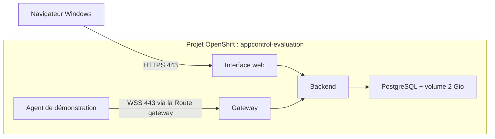
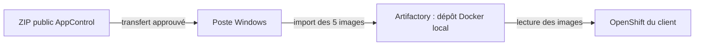

# Variante hors ligne : transporter les images depuis Windows

**Cette variante transporte les images et les outils dans un ZIP de 233 Mio.**
Pour le parcours minimal avec le `oc` déjà installé et des images téléchargées
par OpenShift, suivre le [guide Windows principal](INSTALLATION-WINDOWS.fr.md).
Utiliser la présente variante uniquement si la plateforme demande un transfert
hors ligne des images.

Guide révisé le **31 octobre 2026** pour AppControl **1.20.4**, kit Windows
**1.20.4-1**. La procédure ci-dessous utilise le kit déjà qualifié ; elle ne
demande aucune compilation chez le client.

Le poste Windows sert à piloter l’installation. AppControl s’exécute dans le
projet OpenShift dédié : **quatre pods de base, un agent de démonstration et un
disque persistant de 2 Gio**. L’assistant
utilise **PowerShell Windows et .NET Framework**, avec les outils OpenShift,
Helm et de transfert d’images fournis dans le ZIP. **Python n’est ni installé
ni nécessaire sur le poste client.** Aucun Docker Desktop, WSL ou poste Linux
n’est nécessaire.

Poste attendu : Windows 64 bits avec **Windows PowerShell 5.1 et .NET Framework
4.8**, selon la configuration approuvée par l’équipe poste de travail.

## Ce qui sera installé, et où

**Aucune base PostgreSQL externe ni chaîne de connexion n’est à obtenir pour
ce parcours.** Le kit installe PostgreSQL dans le même projet OpenShift que
AppControl. Il génère son mot de passe, crée la base et configure automatiquement
la connexion chiffrée du backend. Les identifiants sont placés dans des Secrets
OpenShift ; PostgreSQL n’est pas exposé sur Internet.

| Dans le projet OpenShift dédié | Rôle | Installé par |
|---|---|---|
| Interface web — 1 pod | Affiche les applications, les maps et les actions dans le navigateur. | L’assistant |
| Backend — 1 pod | Gère les utilisateurs, les maps, les droits et les opérations. | L’assistant |
| Gateway — 1 pod | Relie les agents à AppControl et transmet les commandes. Elle est incluse. | L’assistant |
| PostgreSQL — 1 pod + volume persistant de 2 Gio | Conserve les données AppControl, notamment les maps et les utilisateurs. | L’assistant |
| Agent de démonstration — 1 pod | Exécute des commandes synthétiques dans son propre conteneur. | La recette, demandée par `-Tester` |

Les cinq pods correspondent à cinq conteneurs en régime stable. Des pods
supplémentaires peuvent exister brièvement pendant les redémarrages de la
recette. Aucun Redis, fournisseur IA, serveur MCP ou service métier de la
banque n’est requis pour cette démonstration.



L’agent ouvre la connexion vers la gateway ; AppControl lui transmet ensuite
les commandes sur cette connexion. La recette teste ce trajet via la Route
OpenShift, même si l’agent se trouve dans le cluster. Les flux réseau autorisés
doivent donc permettre ce trajet et les échanges internes entre les services.

**Une base PostgreSQL gérée par la banque est un autre profil d’installation.**
Le chart Helm sait utiliser une base externe, mais l’assistant Windows livré
ne configure pas ce profil. Ce raccordement demanderait alors une base, des
identifiants, une adresse de connexion et la chaîne de confiance TLS fournis
par la plateforme. Ce n’est pas un préalable à cette première évaluation.

## 1. Préparer le créneau et récupérer le ZIP

Obtenir ces informations auprès de l’équipe OpenShift avant le jour de la démo :

| À préparer | Exemple ou précision |
|---|---|
| Projet dédié déjà créé | `appcontrol-evaluation`, avec les droits de déploiement dans ce projet. |
| Connexion OpenShift | Adresse du serveur et jeton de connexion, ou kubeconfig déjà utilisable sur le poste. |
| Tunnel vers le projet | Autoriser `oc port-forward` : droit `create` sur `pods/portforward`, et tunnel accepté par le réseau/proxy vers l’API. L’assistant l’utilise pour initialiser la gateway ; aucun port entrant supplémentaire sur Windows n’est requis. |
| Registre pour les images | Registre intégré OpenShift accessible depuis le poste, ou endpoint **Docker** Artifactory approuvé avec droits d’import. |
| Lecture des images par les pods | Automatique pour le registre intégré dans le même projet ; secret de pull à prévoir pour un registre privé externe. |
| Stockage | Classe de stockage par défaut utilisable, ou nom de celle à employer ; 2 Gio disponibles. |
| Accès à l’application | Deux Routes sur le domaine du cluster : HTTPS pour l’interface, WSS pour la gateway. Le poste doit faire confiance à leurs certificats. |

Prévoir des nœuds **Linux AMD64** et des quotas compatibles : les quatre services
réservent au total 1,1 vCPU et 960 Mio ; la démonstration ajoute un petit agent de
0,05 vCPU et 32 Mio. Les limites maximales des conteneurs sont plus élevées :
l’équipe plateforme doit également les accepter, avec une marge pour les
redémarrages de la recette. Le stockage doit permettre un volume persistant
`ReadWriteOnce` de 2 Gio.

Il n’y a donc **pas de PostgreSQL, de Docker ou de Python à installer sur le
poste Windows**. Ce poste exécute l’assistant et ouvre l’interface web.

### Où sont les images ? Faut-il un compte GitHub ?

Il faut distinguer le code, les fichiers de livraison et les images :

| Emplacement | Ce qu’il contient | Accès nécessaire pour ce parcours |
|---|---|---|
| Dépôt source `fredericcarre/appcontrol` | Le code du produit ; dépôt privé. | Aucun : le client ne compile pas le produit. |
| [Release publique XComponent](https://github.com/xcomponent/appcontrol-release/releases/tag/v1.20.4) | Le ZIP Windows, les procédures, les rapports et les empreintes. Le ZIP contient les **cinq images déjà construites** sous forme d’archives OCI. | Téléchargement public, sans compte ni mot de passe GitHub. Le fichier peut ensuite être transféré par le canal approuvé de la banque. |
| Registre GitHub `ghcr.io/fredericcarre/appcontrol-*` | Les images d’origine, identifiées précisément dans `images.source.lock.json` du ZIP. | **Non utilisé par l’assistant après réception du ZIP.** |
| Artifactory de la banque, ou registre intégré OpenShift | La copie des cinq images que les pods vont réellement utiliser. | Droits d’import pour l’installation et droits de lecture pour OpenShift. |

Vérification anonyme des références exactes de la release le 31 octobre 2026 :
les images backend, frontend, gateway et agent sont accessibles sur GHCR ;
l’accès anonyme à l’image PostgreSQL est refusé. Il ne faut donc pas supposer
qu’un téléchargement anonyme des **cinq** images depuis GHCR fonctionnera.
Le ZIP public les contient toutes et évite cette dépendance. La visibilité d’un
package GHCR est distincte de celle du dépôt Git de son code.

### Avec Artifactory : le chemin recommandé

Pour ce kit, demander un **dépôt Docker local inscriptible dans Artifactory**.
Ici, « local » signifie stocké dans Artifactory, pas sur le poste Windows.
L’assistant y importe les cinq archives du ZIP ; OpenShift lit ensuite les
images depuis ce registre interne.



**À demander à l’équipe Artifactory avant le créneau :**

| Information | Utilisation |
|---|---|
| Adresse **Docker d’import**, fournie par « Set Me Up » | À saisir dans l’assistant, sous la forme `registre/depot/chemin`, sans `https://`. Ce n’est pas l’adresse de la page web Artifactory. |
| Identifiant et jeton autorisés à importer les cinq images | Connexion du poste Windows au dépôt. Les secrets sont saisis de façon masquée. |
| Adresse Docker de lecture par les nœuds | Dans le parcours interactif simple, utiliser la même adresse pour importer et lire. Si elles diffèrent, préparer la configuration avant le créneau. |
| Identifiant et jeton de lecture pour OpenShift | L’assistant crée le secret de lecture des images dans le projet. Une configuration préparée peut désigner un secret déjà créé par la plateforme. |
| Confiance dans les certificats et flux autorisés | Le poste Windows et les nœuds OpenShift doivent pouvoir joindre le registre et valider son certificat TLS. |

Exemple **fictif**, à remplacer par l’adresse donnée par la plateforme : saisir
`registry.banque.example/docker-appcontrol-local/evaluation`. Avec le préfixe
par défaut, une image sera alors référencée sous
`registry.banque.example/docker-appcontrol-local/evaluation/appcontrol-backend@sha256:…`.
Le digest fixe le contenu exact de l’image ; il est vérifié après import.

Un dépôt virtuel Artifactory peut convenir s’il est configuré pour diriger les
imports vers un dépôt local. Cette configuration relève de l’équipe plateforme.
Artifactory distingue bien les dépôts locaux, distants et virtuels : voir la
[documentation Docker JFrog](https://docs.jfrog.com/artifactory/docs/docker-repositories).

### Et Artifactory utilisé comme proxy de GitHub ?

Oui : un dépôt **distant** Artifactory
peut récupérer les images manquantes dans un registre amont et les mettre en
cache. L’équipe plateforme doit configurer un dépôt Docker distant vers
**GHCR**, ses accès réseau et, pour les packages privés, son authentification
amont. L’accès d’OpenShift à Artifactory est une authentification distincte.

Mais ce n’est **pas le mode de l’assistant livré** : celui-ci importe les images
du ZIP. Un dépôt distant seul n’accepte pas ces imports. Remplacer simplement
l’adresse par celle d’un proxy ne suffit donc pas. Le proxy GHCR demande un
parcours avancé avec des références d’images adaptées et une vérification des
cinq images. Son cache se remplit à la demande, pas à la création du dépôt.
Voir [le fonctionnement des dépôts distants JFrog](https://docs.jfrog.com/artifactory/docs/remote-repositories)
et [l’authentification GHCR](https://docs.github.com/en/packages/working-with-a-github-packages-registry/working-with-the-container-registry).

**Pour cette première installation, retenir : ZIP → import Artifactory local →
OpenShift.** Aucun identifiant GitHub personnel n’est à installer dans le cluster
pour ce parcours. L’autre choix proposé par l’assistant est le registre intégré
OpenShift, si la plateforme autorise son usage depuis le poste.

### Télécharger et extraire le kit

Télécharger les deux fichiers depuis la
[release AppControl 1.20.4](https://github.com/xcomponent/appcontrol-release/releases/tag/v1.20.4) :

- [Kit Windows complet — ZIP](https://github.com/xcomponent/appcontrol-release/releases/download/v1.20.4/appcontrol-openshift-windows-1.20.4-1.zip)
- [Empreinte SHA-256](https://github.com/xcomponent/appcontrol-release/releases/download/v1.20.4/appcontrol-openshift-windows-1.20.4-1.zip.sha256)

Le ZIP contient les cinq images du produit et les outils Windows nécessaires.
Il peut être transféré sur le poste client par le canal approuvé ; l’installation
n’exige ensuite aucun téléchargement sur Internet. Le poste doit pouvoir joindre
l’API OpenShift, le registre et les Routes de l’application.

Depuis PowerShell, dans le dossier contenant les deux fichiers, vérifier le ZIP :

```powershell
$archive = 'appcontrol-openshift-windows-1.20.4-1.zip'
$attendu = ((Get-Content "$archive.sha256" -Raw).Trim() -split '\s+')[0]
$obtenu = (Get-FileHash $archive -Algorithm SHA256).Hash
if ($obtenu -ne $attendu) { throw 'Empreinte incorrecte : ne pas utiliser cette archive.' }
'Empreinte conforme'
```

Puis utiliser **Extraire tout** dans l’Explorateur Windows, dans un dossier court
et local dans votre profil utilisateur, par exemple `Documents\AppControl\kit`. Ne pas lancer l’assistant directement
depuis la vue du ZIP.

## 2. Ouvrir l’assistant

Dans l’Explorateur, ouvrir le dossier extrait qui contient `Installer-AppControl.ps1`.
Cliquer dans la barre d’adresse, taper **powershell**, puis appuyer sur Entrée.
La fenêtre Windows PowerShell s’ouvre directement au bon endroit. Lancer :

```powershell
.\Installer-AppControl.ps1 -Tester
```

Il n’est pas nécessaire de lancer PowerShell en administrateur. Si la politique
de la banque bloque le script ou un exécutable fourni, demander sa validation à
l’équipe poste de travail ; ne pas modifier la politique d’exécution du poste.
Les scripts utilisent le mode PowerShell `FullLanguage` standard ; ils ne
contournent ni les règles d’exécution ni les restrictions de la banque.

L’assistant accompagne les étapes suivantes :

1. **Connexion et projet.** Choisir la connexion existante ou saisir l’adresse du
   serveur et un jeton masqué, puis le projet dédié.
2. **Registre.** Choisir le registre intégré OpenShift ou Artifactory. Dans ce
   dernier cas, utiliser l’adresse Docker fournie par l’équipe plateforme, pas
   l’adresse de l’interface web Artifactory. Les droits d’import du poste et les
   droits de lecture des pods sont deux accès distincts.
3. **Préparation.** Vérifier les droits, le stockage et les noms des Routes,
   puis importer les images en conservant leurs empreintes. Les images sont
   déjà compilées : aucune construction n’a lieu chez le client.
4. **Installation.** Confirmer la cible affichée ; l’assistant déploie AppControl
   et vérifie sa gateway.
5. **Recette demandée par `-Tester`.** L’assistant déploie l’agent dans le cluster,
   l’enrôle auprès de la gateway et crée la map de démonstration. Il vérifie
   ensuite le fonctionnement complet. Sans `-Tester`, le mode interactif
   propose également la recette avec « oui » par défaut ; si elle est refusée,
   l’installation reste à quatre pods, sans agent de démonstration.

L’assistant conserve la configuration et les secrets dans un dossier privé sous
`%LOCALAPPDATA%\AppControl\Installations`, avec des permissions Windows limitées.
Il indique le chemin exact à conserver pour reprendre la même installation.
Ne pas copier ce dossier dans Git, dans un rapport ou dans le ZIP partagé.

**Pour reprendre après une interruption**, copier la commande **Reprendre**
affichée par l’assistant : elle sélectionne son fichier `assistant.json` privé.
Conserver ce dossier permet de réutiliser les identifiants, les certificats et les
images déjà importées. Si le jeton OpenShift a expiré, l’assistant demandera une
nouvelle connexion. Une reprise peut redémarrer la gateway de cette installation ;
la réaliser pendant le créneau d’évaluation.

## 3. Ouvrir AppControl et constater le résultat

À la fin, l’assistant indique l’URL de l’interface et l’emplacement privé des
identifiants administrateur. Ouvrir cette URL dans le navigateur et se connecter.

Si la recette a été exécutée, ouvrir l’application **Qualification dependencies…**
identifiée dans son rapport :

- **Start All** : `database-probe` démarre avant `api-probe` ; les deux passent au vert.
- **Stop All** : les composants s’arrêtent dans l’ordre inverse.
- Ouvrir l’historique pour constater les commandes et leur résultat.

La recette complète vérifie aussi les refus de permission, l’enrôlement de
l’agent, les reconnexions et la persistance. **Elle redémarre la gateway, le
backend et PostgreSQL : l’exécuter uniquement sur cette installation
d’évaluation isolée.** Les commandes de démonstration utilisent des marqueurs de
test ; aucun service métier de la banque n’est appelé.

### Quelles commandes exécute l’agent ?

La map représente la dépendance `api-probe → database-probe`. Les deux composants
sont des simulations dans le pod agent : **`database-probe` n’est pas la base
PostgreSQL d’AppControl** et `api-probe` n’est pas son backend.

| Composant synthétique | Démarrer | Vérifier | Arrêter |
|---|---|---|---|
| `database-probe` | `touch /tmp/database-probe` | `test -f /tmp/database-probe` | `test ! -f /tmp/api-probe && rm /tmp/database-probe` |
| `api-probe` | `test -f /tmp/database-probe && touch /tmp/api-probe` | `test -f /tmp/api-probe` | `rm /tmp/api-probe` |

Le démarrage de l’API exige donc le marqueur de sa dépendance ; l’arrêt de la
base exige que l’API soit arrêtée. Cela permet de constater concrètement
l’ordre des commandes, les couleurs d’état et l’historique dans AppControl.
Ces commandes Linux s’exécutent dans le conteneur de l’agent, **pas sur Windows**.

### Ce qui reste après le test

Conserver le rapport de recette et le dossier privé d’installation séparément.
Une installation réussie laisse AppControl disponible : il n’est pas nécessaire
de garder PowerShell ouvert pour utiliser l’application.

La recette client conserve **les cinq pods et la map**, avec les composants
synthétiques arrêtés à la fin. Il est donc possible de refaire Start All / Stop All dans
le navigateur.

L’agent fourni est toutefois un **agent de qualification temporaire** : son
identité et ses marqueurs sont stockés dans des volumes éphémères. Ils survivent
aux redémarrages du backend, de la gateway ou de PostgreSQL, mais pas au
remplacement du pod agent. Son jeton d’enrôlement initial est à usage unique.
Si ce pod est recréé, relancer la recette via la commande de reprise avec
`-Tester` crée un nouvel agent et une nouvelle map ; utiliser la nouvelle map
indiquée dans le rapport. L’ancienne reste liée à l’ancien agent. Un agent à
conserver durablement demande un stockage persistant de son identité.

## Ce qui a réellement été testé avant livraison

Le **31 octobre 2026**, le kit distribué a été exécuté depuis Windows Server 2022
avec **Windows PowerShell 5.1**, contre une vraie sandbox Red Hat
**OpenShift 4.21.30**. Les cinq images ont été importées dans le registre intégré
OpenShift ; PostgreSQL était inclus, avec son volume. Aucun PostgreSQL externe
n’a été utilisé.

La qualification a vérifié la connexion HTTPS, le refus d’accès anonyme,
l’enrôlement réel de l’agent, les restrictions de sécurité des pods, le refus
d’exécution avec une clé en lecture seule, le démarrage et l’arrêt dans l’ordre
des dépendances, puis les reconnexions et la conservation de la map après
redémarrage de la gateway, du backend et de PostgreSQL. La reprise de
l’installation a également été testée. Le parcours client d’installation et
de recette n’a appelé ni Python, ni Docker, ni WSL, ni Bash, ni OpenSSL.

[Rapport de qualification Windows](https://github.com/xcomponent/appcontrol-release/releases/download/v1.20.4/QUALIFICATION-WINDOWS-v1.20.4.fr.md)
et [preuves de qualification](https://github.com/xcomponent/appcontrol-release/releases/download/v1.20.4/QUALIFICATION-WINDOWS-v1.20.4.zip).
La CI supprime son installation de test après vérification ; **l’assistant
client conserve l’installation du client**.

L’Artifactory, les certificats, les règles réseau et les droits de la banque
n’ont pas encore été testés. La recette exécutée chez le client servira à
valider cet environnement. Le temps nécessaire dépend surtout de la préparation
de ces accès ; le kit ne permet pas de garantir une installation en quelques
minutes tant qu’ils ne sont pas disponibles.

## Si une étape bloque

| Message ou symptôme | Prochaine action |
|---|---|
| Connexion refusée ou jeton expiré | Renouveler la connexion OpenShift avec la procédure de la banque, puis reprendre le même dossier d’installation. |
| Droit manquant dans le projet | Faire attribuer le droit indiqué par le précontrôle ; les pods n’ont pas besoin de `cluster-admin` ni de SCC `anyuid`. |
| Registre intégré inaccessible depuis Windows | Demander sa Route approuvée ou utiliser le registre Artifactory de la banque. |
| Image non récupérable par un pod | Vérifier l’adresse de registre, le secret de pull et la confiance TLS des nœuds. |
| Volume en attente | Vérifier la classe de stockage et le quota du projet. |
| Erreur de certificat | Faire installer la CA approuvée dans les magasins de confiance concernés ; ne pas désactiver TLS. |
| Dossier d’état manquant pour une installation existante | Restaurer le dossier privé d’origine avant de poursuivre, afin de conserver les identifiants et certificats. |

Le projet dédié sépare les objets et les données de cette installation. Il
n’alloue pas à lui seul des nœuds physiques réservés ; l’isolation réseau et les
quotas restent ceux définis par la plateforme OpenShift du client.

## Après la première démonstration

La gateway est déjà incluse. Pour raccorder un agent extérieur au cluster,
prévoir sa connexion **sortante WSS 443** vers la gateway, son certificat de
confiance et un jeton d’enrôlement à usage unique. Suivre ensuite la
[procédure d’enrôlement](https://xcomponent.github.io/appcontrol-release/qualification/INSTALLATION-CLIENT-v1.20.4.fr/#5-ajouter-un-agent-exterieur-au-cluster).

Ce parcours fournit une évaluation mono-instance. Le raccordement au SSO, à la
PKI et à la base gérée du client, la sauvegarde/restauration et la haute
disponibilité se cadrent ensuite pour le POC. Les certificats de service générés
durent 90 jours et le jeton de gateway 30 jours ; leur renouvellement est explicite.

Les rapports CVE de la release 1.20.4 concernent les images du produit. Les
exécutables Windows ajoutés sont les distributions officielles d’OpenShift, Helm
et regctl, avec versions et empreintes fixées dans `tools.lock.json` ; ce fichier
n’est pas un rapport de scan de ces exécutables. Ils peuvent être soumis au
contrôle du poste de travail avant le créneau.

Les preuves de qualification du **kit Windows** doivent être lues avec le paquet
distribué : elles précisent la version de Windows et de PowerShell réellement
testée. Elles complètent les preuves des images AppControl 1.20.4 sans modifier
le kit Linux/macOS original. Le rapport exécuté dans le projet du client reste
la preuve de son installation propre.
