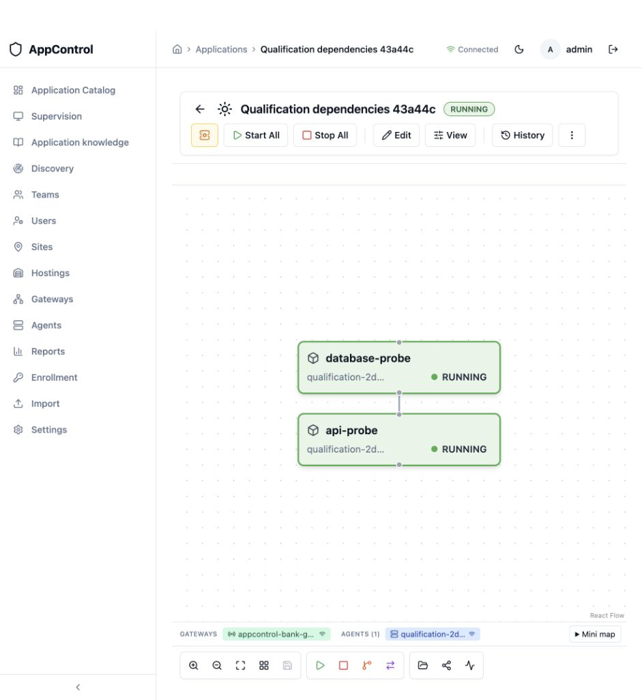

# Qualification finale OpenShift — 8 octobre 2026

**Le candidat d’évaluation ed757ba passe les dix contrôles OpenShift réels,
les quatre contrôles d’agent externe et l’import hors ligne de ses cinq images.**
La CI 37740566560
est verte. Les anciens paquets intermédiaires ne doivent pas être distribués.

## Version et plateforme

- Sources : `ed757bac1b84468063fead91b3c778c65753346e`.
- Compilation CI : merge temporaire `1aa0e94eddf2b614bc5fca09bdfb855f7833dce4`,
  sans différence de sources avec cette branche dans crates, frontend, migrations,
  Helm, scripts et Docker. Aucune fusion vers main n’a été effectuée.
- OpenShift 4.21.30, projet Sandbox `frecarre-dev`, release `appcontrol-bank`.
- Quatre services : interface, backend, gateway, PostgreSQL. Un agent synthétique
  supplémentaire pour la recette ; aucun Redis.
- Services Rust sur UBI 10 minimal ; nginx et PostgreSQL 16 sur Alpine mise à jour.
  Cinq images identifiées par digest, exportées en OCI et vérifiées après transfert.
- Pods sous `restricted-v2`, UID attribué par OpenShift, racines en lecture seule,
  capacités supprimées, sans privilège supplémentaire ni jeton Kubernetes monté.

## Recette réelle

1. Connexion HTTPS vérifiée à travers la Route réencryptée.
2. Refus de consultation sans authentification.
3. Enrôlement agent par la Route gateway avec TLS vérifié et backend mTLS.
4. Vérification des Routes et de la SCC des cinq pods.
5. Clé en lecture seule : lecture autorisée, démarrage refusé avec HTTP 403.
6. Commandes réelles : démarrage de la dépendance avant son consommateur.
7. Commandes réelles : arrêt du consommateur avant sa dépendance.
8. Redémarrage gateway : reconnexion et nouvelle exécution réussies.
9. Map persistante après redémarrage backend.
10. Map persistante et reconnexion backend après redémarrage PostgreSQL.

[Preuve JSON](evidence/openshift-2026-10-08/functional-current.json).
Les commandes manipulent des marqueurs locaux et vérifient réellement leurs
préconditions ; elles ne constituent pas la recette d’une application bancaire.

La map `2ccf6094-9e9d-4d02-beb7-182480d42707` a ensuite été démarrée depuis
l’interface, après les redémarrages : ses deux composants sont RUNNING.

## Agent extérieur et transfert des images

Un agent Linux dans un conteneur UBI 10 sur le Mac, **hors Kubernetes**, a été
ensuite enrôlé via la Route WSS 443. Démarrage, arrêt et reconnexion avec les
certificats persistés passent : [quatre contrôles](evidence/openshift-2026-10-08/external-agent-current.json).
Aucun port entrant n’a été ouvert sur l’hôte de cet agent. Cela ne qualifie pas
une VM RHEL 8/9 : le binaire livré exige glibc 2.39.

Les cinq archives finales ont été importées dans un registre TLS isolé par le
script client, avec conservation des digests : [preuve](evidence/openshift-2026-10-08/offline-transfer-current.json).
Aucun registre de la banque n’était disponible pour ce test.

## Sécurité et corrections

Les scans Trivy 0.75.0 des cinq images exactes et des dépendances applicatives de
production n’indiquent aucune vulnérabilité. Deux alertes restent dans les outils
CSS de développement ; elles ne sont pas exclues des rapports. Le [rapport détaillé](SECURITE-DEPENDANCES-2026-10-08.fr.md)
explique aussi l’insuffisance du premier scan limité aux images système.

Corrections notables : port WSS implicite 443, sorties réseau explicites,
précontrôle et JSON d’installation, attente de connexion réelle de la gateway,
reconnexion de l’agent bornée et sortie sur fin de flux, protection d’une nouvelle
connexion gateway contre le nettoyage de l’ancienne, rétention de deux anciennes
révisions pour limiter les quotas, bibliothèques JWT/TLS corrigées, suppression
des traces de saisie du terminal dans la console navigateur.

Validation locale : 162 tests backend, 85 tests agent, tests common/gateway,
Clippy workspace, 310 tests frontend, build/lint frontend et 17 contrôles Python.
La CI ajoute les recettes PostgreSQL, SQLite, Windows, Kubernetes restreint et
OpenShift réel. Les rapports complets et SBOM accompagnent le kit.

## Limites pour le POC suivant

Backend unique et mises à jour avec interruption ; PKI d’évaluation avec rotation
explicite ; intégration SSO/PKI/base externe client à qualifier ; sauvegarde et
restauration à tester ; reprise durable/idempotence des opérations destructives
interrompues à compléter. La persistance après redémarrage ne prouve pas une
restauration. Les scans datés ne constituent pas une garantie d’absence de faille.

Voir la [liste des travaux](AVANT-LIVRAISON.fr.md), l’[audit bancaire](AUDIT-BANQUE-2026-10-08.fr.md)
et le [guide réseau, images et agents](RESEAU-IMAGES-AGENTS.fr.md).
