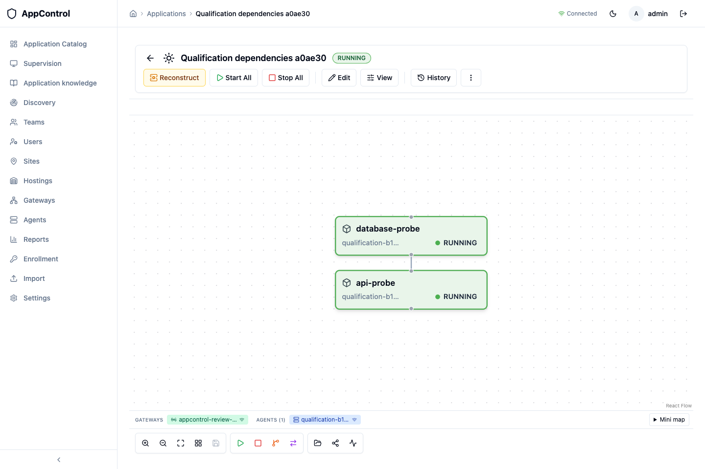

# AppControl — candidat d’évaluation OpenShift du 28 octobre 2026

**Prêt pour une première évaluation isolée chez le client.** Le candidat
`openshift-evaluation-2026.10.28-rc1` a été reconstruit, installé sur OpenShift
réel et testé avec ses cinq images exactes. Il fournit quatre services, dont
la gateway, et un agent supplémentaire pour la recette. Aucun Redis, aucune
compilation et aucune connexion à une IA ne sont nécessaires chez le client.

Cette livraison sert à découvrir AppControl et préparer un POC sur une application
non critique. Elle ne constitue pas une qualification de production bancaire.
XComponent 4 Business reste une maquette distincte, hors de ce kit.

## Version et provenance

| Élément | Référence |
|---|---|
| Sources applicatives | `2268728478f117b2b578109eb9a2652794b74485` |
| Compilation CI | `0c4e7d1a85f68f4a9dacb99c8b23cfe0a81c8265` |
| Branche conservant les évolutions et démonstrations | `demo/banking-reconstruction` |
| Plateforme livrée | Linux AMD64 |
| Recette réelle | OpenShift 4.21.30, Sandbox Red Hat, projet `frecarre-dev` |
| Installation neuve | `appcontrol-review-20261028` |
| Images natives | UBI 10 minimal ; interface et PostgreSQL 16 sur Alpine corrigée |

La [comparaison des sources](evidence/openshift-2026-10-28/source-equivalence.json)
ne relève aucune différence entre la branche et le merge temporaire compilé dans
les chemins applicatifs, migrations, scripts, chart, Docker et lockfiles.
Les [artefacts compilés](evidence/openshift-2026-10-28/ci-artifacts.json) ont été
comparés aux fichiers présents dans les images :
[vérification des contenus](evidence/openshift-2026-10-28/packaged-payloads.json).
Le fichier `provenance.json` du kit précise aussi le commit de livraison ;
`images.source.lock.json` contient les cinq références immuables.

## Résultats sur le livrable exact

| Contrôle | Résultat |
|---|---|
| Installation neuve par le script client, PKI et gateway incluses | PASS |
| Recette OpenShift via les Routes HTTPS/WSS réelles | 10 contrôles PASS |
| Chrome : connexion, map, démarrage et arrêt réels | 4 contrôles PASS ; aucune erreur JavaScript observée |
| Agent UBI 10 extérieur au cluster | 4 contrôles PASS |
| Import des 5 archives OCI dans un registre TLS isolé | PASS ; tous les digests conservés |
| Scans des 5 images finales | 0 alerte, toutes sévérités |
| Dépendances applicatives de production et de développement | 0 alerte, toutes sévérités |
| Tests locaux après correction des dépendances | 667 réussis ; 17 contrôles Python et lint Helm réussis |

La [recette OpenShift](evidence/openshift-2026-10-28/functional-current.json)
vérifie HTTPS, refus anonyme, enrôlement TLS/mTLS, SCC, refus d’exécution avec
une clé lecture seule, ordre start/stop, reconnexion gateway et persistance
après redémarrage du backend puis de PostgreSQL.

L’[inspection du cluster](evidence/openshift-2026-10-28/cluster-current.json)
confirme cinq pods prêts sous `restricted-v2`, les images attendues, des racines
en lecture seule, sans escalade de privilèges ni jeton Kubernetes monté.
La Route interface est réencryptée ; la Route gateway utilise le passthrough TLS.

Le [parcours navigateur](evidence/openshift-2026-10-28/browser-current.json)
a été exécuté après ces redémarrages. Les deux composants ont été démarrés puis
arrêtés depuis l’interface. Voici leur état pendant le démarrage réussi :

L’[agent extérieur](evidence/openshift-2026-10-28/external-agent-current.json)
utilise WSS/443 avec CA vérifiée et jeton à usage unique. Son conteneur est recréé
sans jeton, avec les certificats conservés, puis exécute de nouvelles commandes.
Le conteneur de test a été supprimé. Cela ne qualifie pas une VM RHEL 8/9.

L’[import hors ligne](evidence/openshift-2026-10-28/offline-transfer-current.json)
utilise le script client inchangé et les cinq archives finales. Un certificat
non approuvé est refusé ; la CA approuvée est acceptée. Aucun registre de la
banque n’était disponible pour ce contrôle.

## Sécurité et CI générale

Trivy 0.76.1, avec sa base du 28 octobre, ne remonte aucune alerte sur les images
livrées et les dépendances de leurs sources, sans exclusion. Lire le
[rapport de sécurité](SECURITE-DEPENDANCES-2026-10-28.fr.md) pour le détail des
correctifs et du comparatif avec le kit du 8 octobre, désormais remplacé.

**La CI générale n’est pas entièrement verte.** Les compilations et tests
fonctionnels du run 40669149665,
notamment OpenShift, réussissent ; son scan Kubernetes refuse les bases Wolfi
épinglées des images génériques. Ces images diffèrent des UBI 10/Alpine livrées
et qualifiées ici. Le [diagnostic](evidence/openshift-2026-10-28/ci-restricted-diagnostic.json)
et le [statut complet](evidence/openshift-2026-10-28/ci-current.json) sont conservés.
Le contrôle de sécurité reste actif. La publication d’évaluation ne promeut
ni les images génériques refusées ni un tag `latest`.

## Installer chez le client

Commencer par `LISEZ-MOI.md` à la racine du kit : vérifier les empreintes,
importer les images dans le registre interne, adapter `client.json`, lancer
le précontrôle, l’installation puis la recette. Conserver séparément le dossier
privé généré. Voir la [procédure détaillée](INSTALLATION-EVALUATION.fr.md) et le
[guide réseau et agents](RESEAU-IMAGES-AGENTS.fr.md).

Le parcours utilise une release Helm, quatre services, 1,1 vCPU et 960 Mio
réservés, un volume de 2 Gio et deux Routes sur 443. Le cinquième pod sert à la
recette. Registre, CA, stockage et flux restent à approuver par l’équipe plateforme.

Le backend reste mono-instance. La PKI d’évaluation nécessite une rotation
explicite : jeton gateway de 30 jours et certificats de service de 90 jours.
SSO, PKI/base client, restauration et reprise durable des opérations destructives
restent à qualifier. Les commandes synthétiques manipulent des marqueurs,
sans charge ni données bancaires. L’agent nécessite glibc 2.39 : une VM RHEL 8/9
demande un artefact compatible et une nouvelle recette.

La [liste avant production](AVANT-LIVRAISON.fr.md) distingue ces travaux de la
première installation. Rafraîchir les scans avant une remise ultérieure ou
après reconditionnement ; ils ne garantissent jamais l’absence de faille.
